
<a href="https://github.com/vllm-project/production-stack/pull/1089"><picture><source media="(prefers-color-scheme: dark)" srcset="https://raw.githubusercontent.com/dundysm/dundysm/main/img/dark/00-0.png?v=12301fee">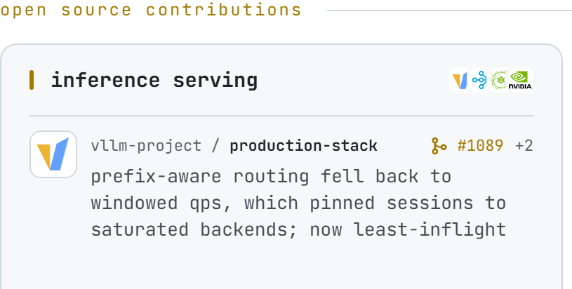</picture></a><a href="https://github.com/google-deepmind/mujoco_warp/pull/1813"><picture><source media="(prefers-color-scheme: dark)" srcset="https://raw.githubusercontent.com/dundysm/dundysm/main/img/dark/00-1.png?v=770aac6f">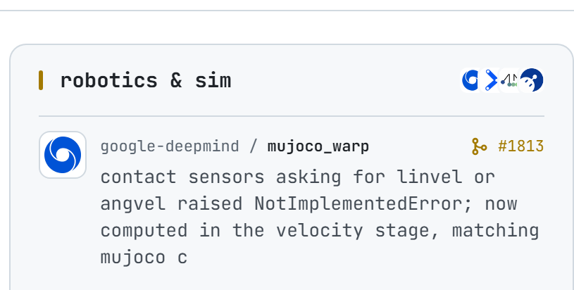</picture></a><a href="https://github.com/ray-project/ray/pull/66307"><picture><source media="(prefers-color-scheme: dark)" srcset="https://raw.githubusercontent.com/dundysm/dundysm/main/img/dark/01-0.png?v=e99bc098">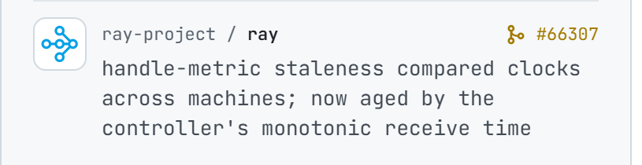</picture></a><a href="https://github.com/google-deepmind/mujoco_menagerie/pull/334"><picture><source media="(prefers-color-scheme: dark)" srcset="https://raw.githubusercontent.com/dundysm/dundysm/main/img/dark/01-1.png?v=9e6d247c">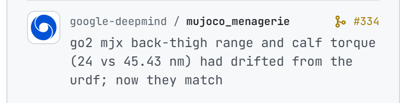</picture></a><a href="https://github.com/ai-dynamo/dynamo/pull/15371"><picture><source media="(prefers-color-scheme: dark)" srcset="https://raw.githubusercontent.com/dundysm/dundysm/main/img/dark/02-0.png?v=09f6067e">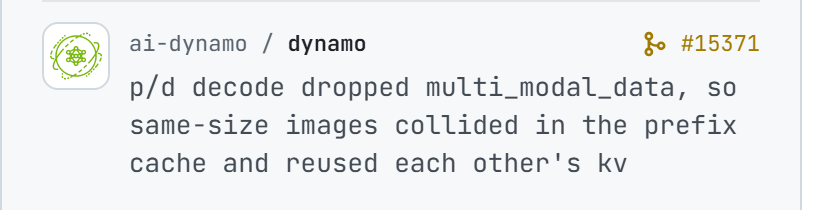</picture></a><a href="https://github.com/moveit/moveit2/pull/3853"><picture><source media="(prefers-color-scheme: dark)" srcset="https://raw.githubusercontent.com/dundysm/dundysm/main/img/dark/02-1.png?v=34c94bc4"></picture></a><a href="https://github.com/NVIDIA/TensorRT-Model-Connect/pull/1284"><picture><source media="(prefers-color-scheme: dark)" srcset="https://raw.githubusercontent.com/dundysm/dundysm/main/img/dark/03-0.png?v=6a903e86">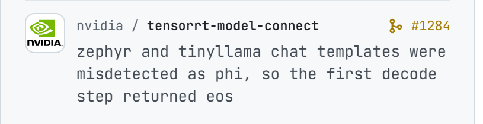</picture></a><a href="https://github.com/newton-physics/newton/pull/4780"><picture><source media="(prefers-color-scheme: dark)" srcset="https://raw.githubusercontent.com/dundysm/dundysm/main/img/dark/03-1.png?v=73be7de4">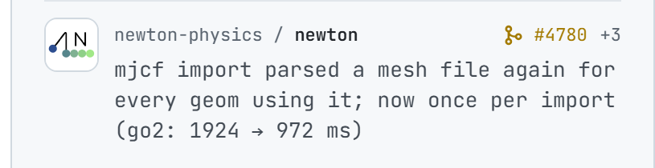</picture></a><a href="https://github.com/ai-dynamo/aiperf/pull/1436"><picture><source media="(prefers-color-scheme: dark)" srcset="https://raw.githubusercontent.com/dundysm/dundysm/main/img/dark/04-0.png?v=49831101">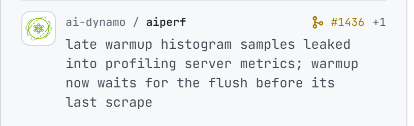</picture></a><a href="https://github.com/Roboparty/rpo_description/pull/5"><picture><source media="(prefers-color-scheme: dark)" srcset="https://raw.githubusercontent.com/dundysm/dundysm/main/img/dark/04-1.png?v=74063e87">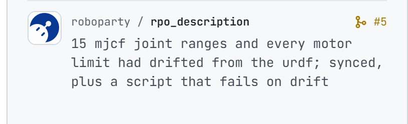</picture></a><a href="https://github.com/vllm-project/router/pull/456"><picture><source media="(prefers-color-scheme: dark)" srcset="https://raw.githubusercontent.com/dundysm/dundysm/main/img/dark/05-0.png?v=de01afdb">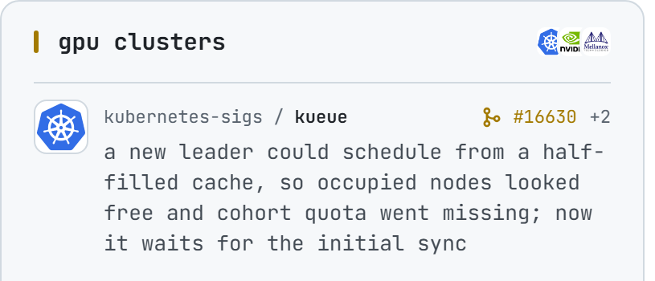</picture></a><a href="https://github.com/Roboparty/human-humanoid-tools/pull/14"><picture><source media="(prefers-color-scheme: dark)" srcset="https://raw.githubusercontent.com/dundysm/dundysm/main/img/dark/05-1.png?v=a7abe2cd">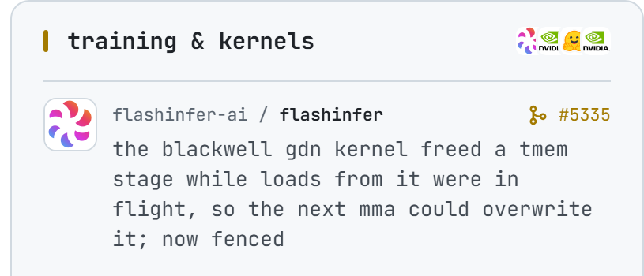</picture></a><a href="https://github.com/kubernetes-sigs/kueue/pull/16630"><picture><source media="(prefers-color-scheme: dark)" srcset="https://raw.githubusercontent.com/dundysm/dundysm/main/img/dark/06-0.png?v=f72d358c"></picture></a><a href="https://github.com/flashinfer-ai/flashinfer/pull/5335"><picture><source media="(prefers-color-scheme: dark)" srcset="https://raw.githubusercontent.com/dundysm/dundysm/main/img/dark/06-1.png?v=b7fe9df7"></picture></a><a href="https://github.com/NVIDIA/gpu-operator/pull/2843"><picture><source media="(prefers-color-scheme: dark)" srcset="https://raw.githubusercontent.com/dundysm/dundysm/main/img/dark/07-0.png?v=113d27a4">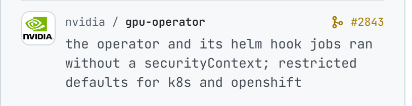</picture></a><a href="https://github.com/NVIDIA/TransformerEngine/pull/3565"><picture><source media="(prefers-color-scheme: dark)" srcset="https://raw.githubusercontent.com/dundysm/dundysm/main/img/dark/07-1.png?v=f4850634">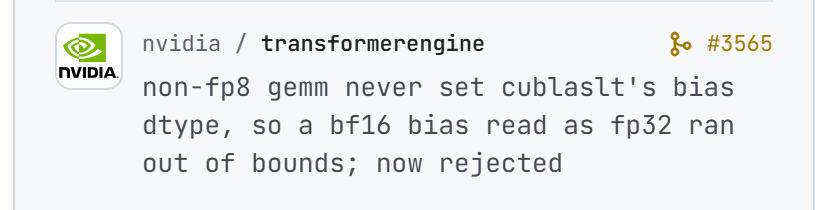</picture></a><a href="https://github.com/Mellanox/network-operator/pull/3189"><picture><source media="(prefers-color-scheme: dark)" srcset="https://raw.githubusercontent.com/dundysm/dundysm/main/img/dark/08-0.png?v=235b375a"></picture></a><a href="https://github.com/huggingface/candle/pull/3973"><picture><source media="(prefers-color-scheme: dark)" srcset="https://raw.githubusercontent.com/dundysm/dundysm/main/img/dark/08-1.png?v=6e213424">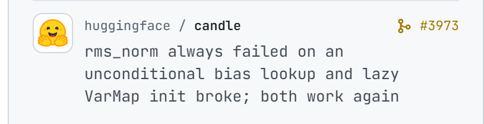</picture></a><a href="https://github.com/Mellanox/k8s-rdma-shared-dev-plugin/pull/329"><picture><source media="(prefers-color-scheme: dark)" srcset="https://raw.githubusercontent.com/dundysm/dundysm/main/img/dark/09-0.png?v=32ec0bfc">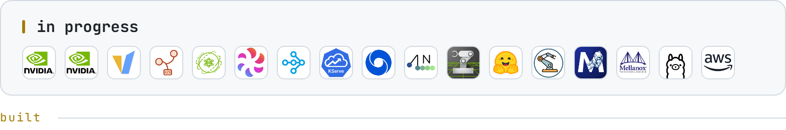</picture></a><a href="https://github.com/NVIDIA-NeMo/Automodel/pull/3999"><picture><source media="(prefers-color-scheme: dark)" srcset="https://raw.githubusercontent.com/dundysm/dundysm/main/img/dark/09-1.png?v=985bdb15">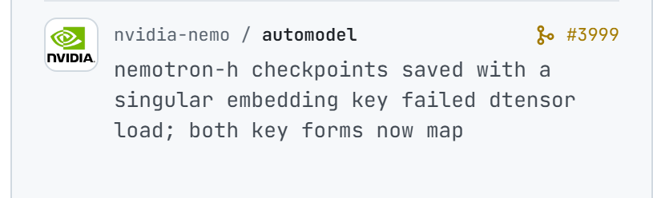</picture></a><a href="https://github.com/Mellanox/maintenance-operator/pull/243"><picture><source media="(prefers-color-scheme: dark)" srcset="https://raw.githubusercontent.com/dundysm/dundysm/main/img/dark/10-0.png?v=791f8335">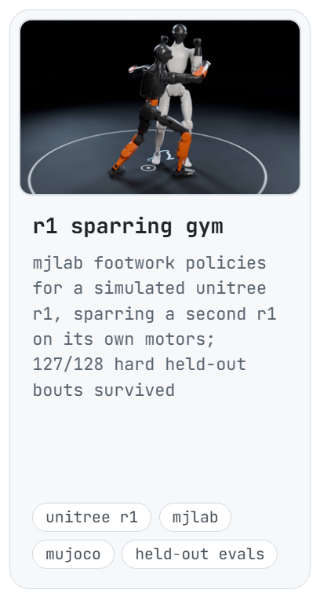</picture></a><a href="https://github.com/search?q=author%3Adundysm+is%3Apr+is%3Amerged+-user%3Adundysm&amp;type=pullrequests"><picture><source media="(prefers-color-scheme: dark)" srcset="https://raw.githubusercontent.com/dundysm/dundysm/main/img/dark/10-1.png?v=75bb7599">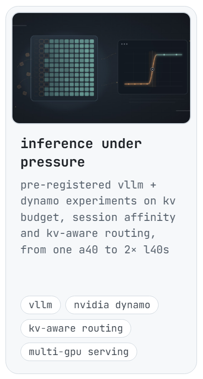</picture></a><a href="https://github.com/search?q=author%3Adundysm+is%3Apr+is%3Aopen+-user%3Adundysm&amp;type=pullrequests"><picture><source media="(prefers-color-scheme: dark)" srcset="https://raw.githubusercontent.com/dundysm/dundysm/main/img/dark/11-0.png?v=7f5d2b1e">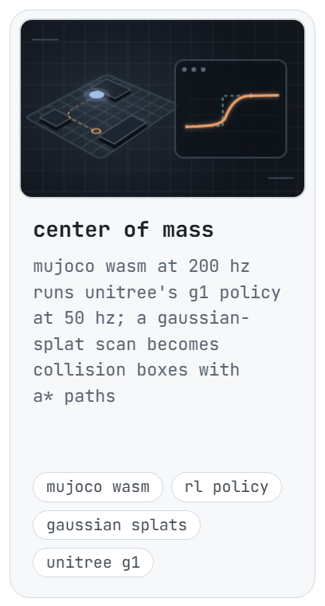</picture></a><a href="https://github.com/dundysm/r1-sparring-gym"><picture><source media="(prefers-color-scheme: dark)" srcset="https://raw.githubusercontent.com/dundysm/dundysm/main/img/dark/12-0.png?v=41bc2659">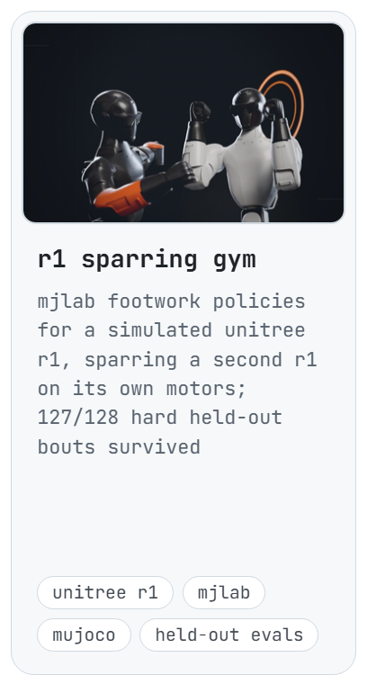</picture></a><a href="https://github.com/dundysm/occlubench"><picture><source media="(prefers-color-scheme: dark)" srcset="https://raw.githubusercontent.com/dundysm/dundysm/main/img/dark/12-1.png?v=6823ce61">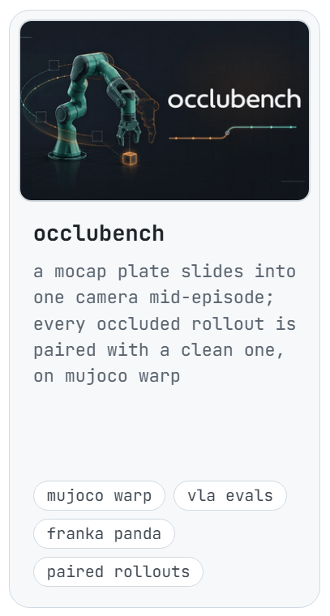</picture></a><a href="https://github.com/dundysm/inference-under-pressure"><picture><source media="(prefers-color-scheme: dark)" srcset="https://raw.githubusercontent.com/dundysm/dundysm/main/img/dark/12-2.png?v=20da0be5"></picture></a><a href="https://github.com/dundysm/gaitkeeper"><picture><source media="(prefers-color-scheme: dark)" srcset="https://raw.githubusercontent.com/dundysm/dundysm/main/img/dark/12-3.png?v=a17adec3">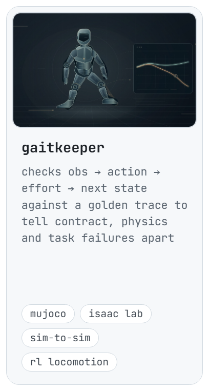</picture></a><a href="https://github.com/dundysm/inference-doctor"><picture><source media="(prefers-color-scheme: dark)" srcset="https://raw.githubusercontent.com/dundysm/dundysm/main/img/dark/13-0.png?v=1fda5472">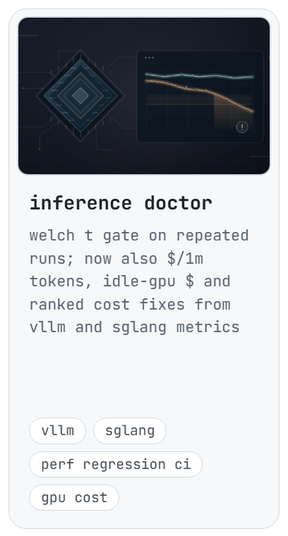</picture></a><a href="https://dundysm.github.io/center-of-mass/"><picture><source media="(prefers-color-scheme: dark)" srcset="https://raw.githubusercontent.com/dundysm/dundysm/main/img/dark/13-1.png?v=2c3ba1ab"></picture></a><a href="https://dundysm.github.io/forgetting/"><picture><source media="(prefers-color-scheme: dark)" srcset="https://raw.githubusercontent.com/dundysm/dundysm/main/img/dark/13-2.png?v=99b97801">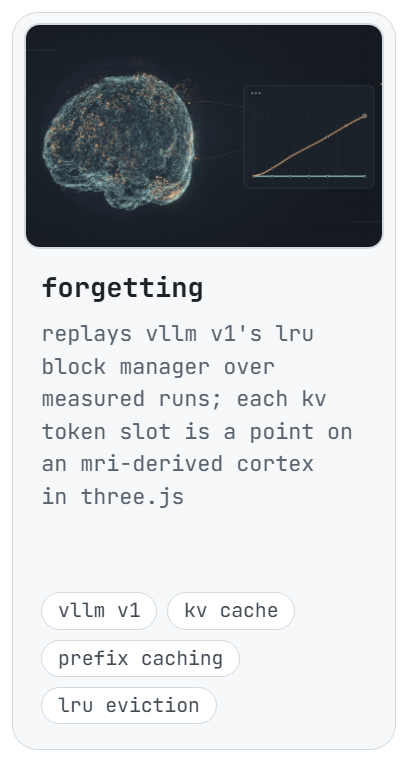</picture></a><a href="https://github.com/dundysm/sea-of-fog"><picture><source media="(prefers-color-scheme: dark)" srcset="https://raw.githubusercontent.com/dundysm/dundysm/main/img/dark/13-3.png?v=9bd92600">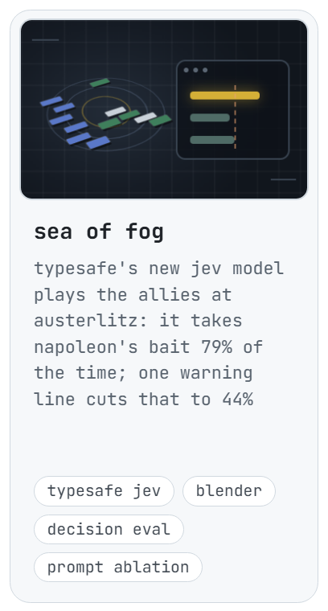</picture></a>

