
<a href="https://github.com/vllm-project/production-stack/pull/1089">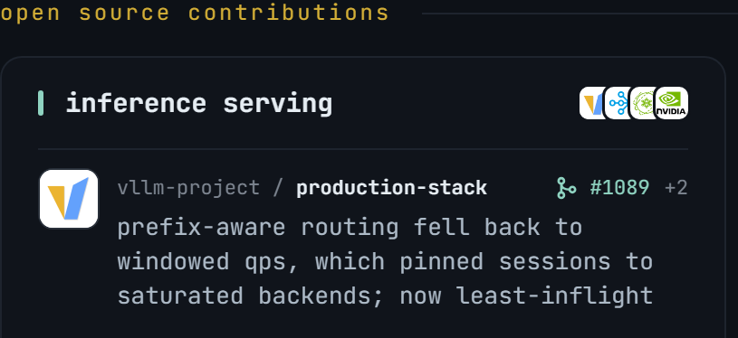</a><a href="https://github.com/google-deepmind/mujoco_menagerie/pull/334">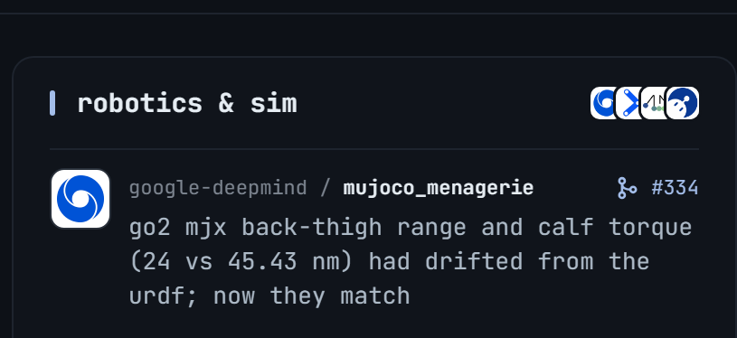</a><a href="https://github.com/ray-project/ray/pull/66307">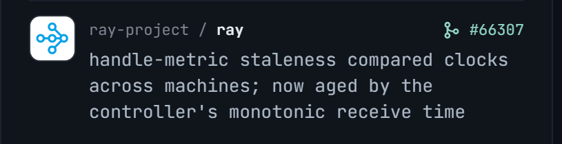</a><a href="https://github.com/moveit/moveit2/pull/3853">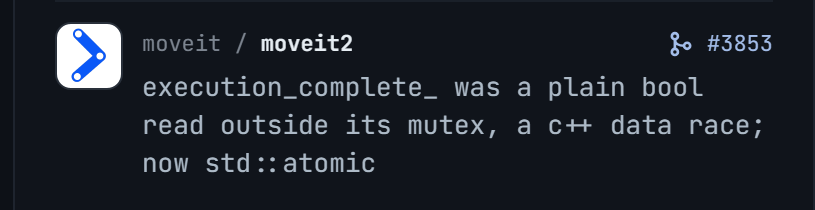</a><a href="https://github.com/ai-dynamo/dynamo/pull/15371">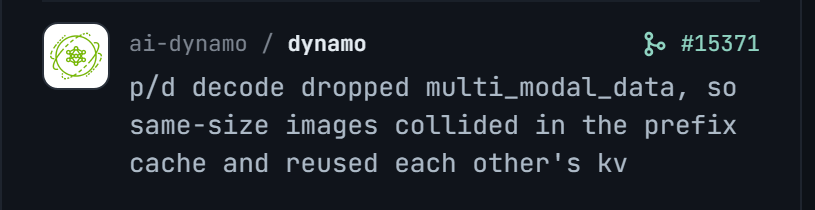</a><a href="https://github.com/newton-physics/newton/pull/4671">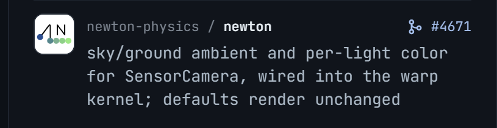</a><a href="https://github.com/NVIDIA/TensorRT-Model-Connect/pull/1284">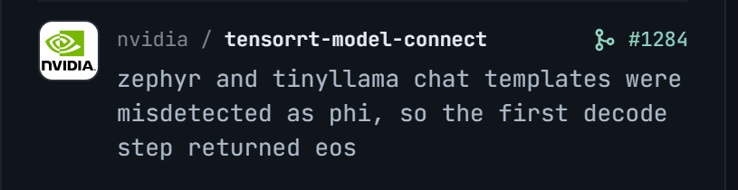</a><a href="https://github.com/Roboparty/rpo_description/pull/5">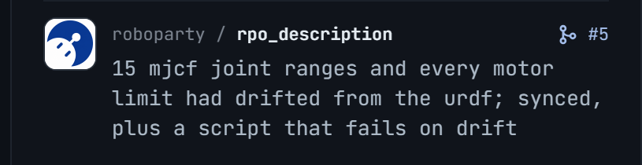</a><a href="https://github.com/ai-dynamo/aiperf/pull/1419">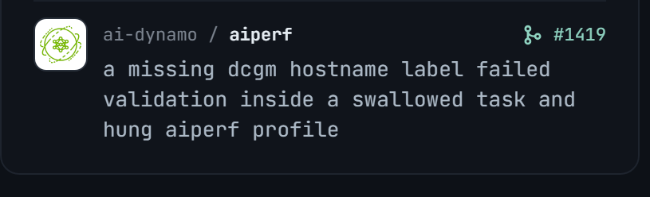</a><a href="https://github.com/NVIDIA/gpu-operator/pull/2843">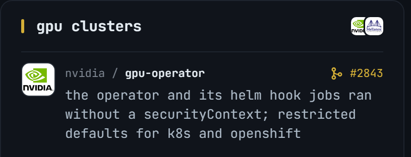</a><a href="https://github.com/NVIDIA/TransformerEngine/pull/3565">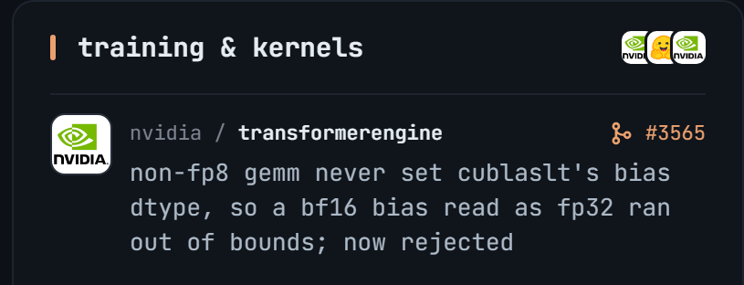</a><a href="https://github.com/Mellanox/network-operator/pull/3189">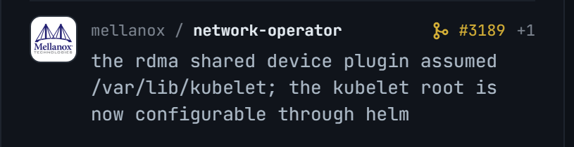</a><a href="https://github.com/huggingface/candle/pull/3973">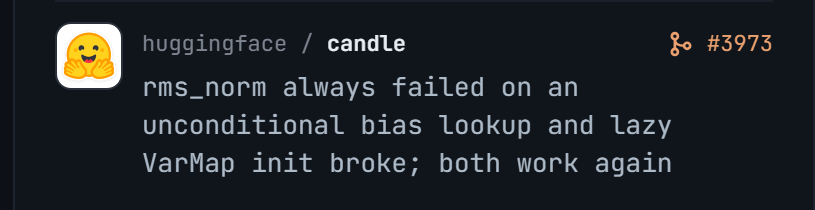</a><a href="https://github.com/Mellanox/maintenance-operator/pull/243">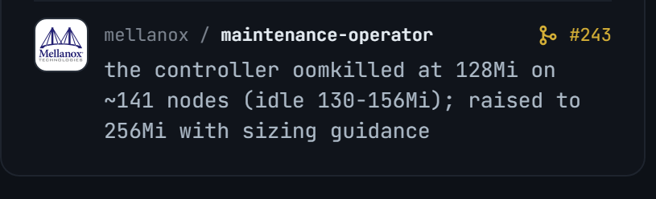</a><a href="https://github.com/NVIDIA-NeMo/Automodel/pull/3999">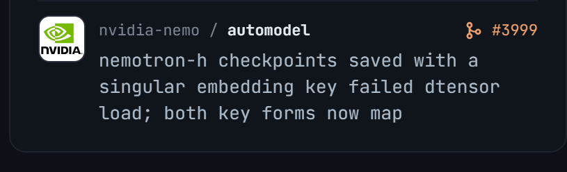</a><a href="https://github.com/search?q=author%3Adundysm+is%3Apr+is%3Aopen+-user%3Adundysm&amp;type=pullrequests">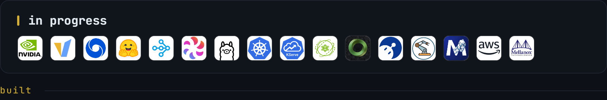</a><a href="https://dundysm.github.io/center-of-mass/">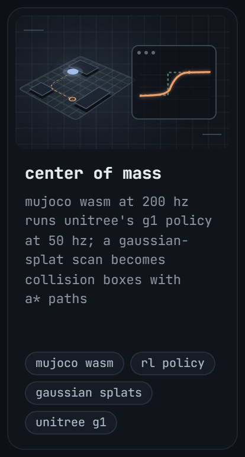</a>

